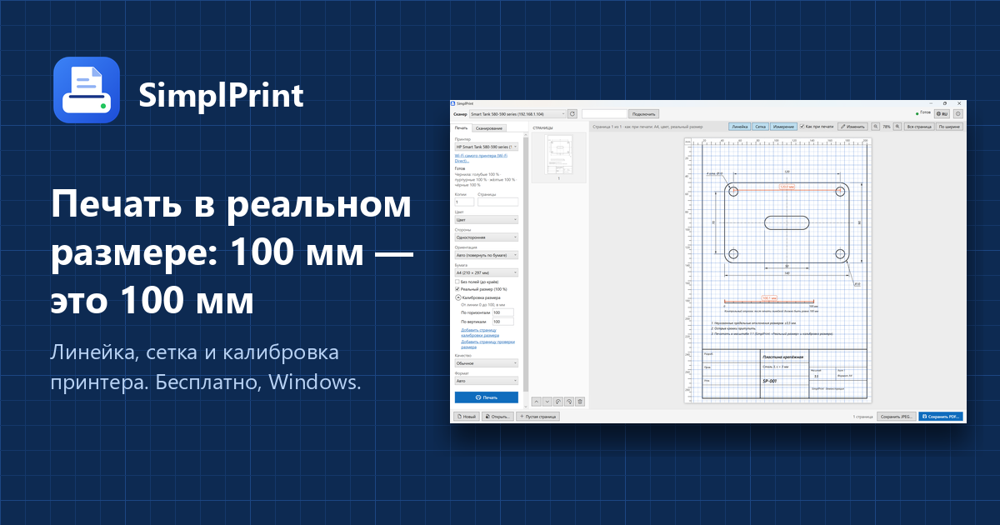

# SimplPrint

**Простая инженерная печать для Windows.** Чертежи, шаблоны и выкройки печатаются в реальном размере: линейка, сетка
и измерения поверх предпросмотра, калибровка масштаба принтера, печать без полей с калибровкой. Печать и
сканирование без драйверов: сеть (IPP Everywhere, AirPrint, Mopria, eSCL), USB, Wi-Fi Direct, в том числе с VPN.

**Simple engineering printing for Windows.** Drawings, templates and patterns print at their real size: a ruler, a
grid and measuring over the print preview, printer scale calibration, calibrated borderless printing. Printing and
scanning without drivers: network (IPP Everywhere, AirPrint, Mopria, eSCL), USB, Wi-Fi Direct, also with a VPN on.

- Сайт / Website: <https://simplprint.site/>
- **[Скачать SimplPrint.exe / Download](https://github.com/Gameqwerty/simplprint-app/releases/latest/download/SimplPrint.exe)**
  (Windows 10/11 x64, без установки / no installation) · [все версии / all versions](https://github.com/Gameqwerty/simplprint-app/releases)

## Бета-тестирование / Beta testing

SimplPrint сейчас в открытой бете. Сообщайте об ошибках и идеях:

- [Issues](https://github.com/Gameqwerty/simplprint-app/issues/new/choose) этого репозитория
- Telegram: [@nadavydov](https://t.me/nadavydov)
- E-mail: nikita1907davidov@gmail.com

SimplPrint is in open beta. Please report bugs and ideas in this repository's
[Issues](https://github.com/Gameqwerty/simplprint-app/issues/new/choose), on Telegram or by e-mail.

Этот репозиторий содержит сайт и сборки программы; исходный код хранится отдельно. / This repository holds the website
and the app's builds; the source code is kept separately.

SimplPrint основан на [PrinterDesk](https://github.com/Miguel897/printerdesk) от Miguel. Лицензия / License: [MIT](LICENSE).
